# UltramarineGun

Simulador de **bólter** de Warhammer 40K (colores Ultramarines) para tablet Android, hecho con
**Blender 4.5** y **Godot 4.7**. La tablet se sostiene en horizontal como un arma:

- **Disparar:** con un tirón de la tablet (acelerómetro) o con el pulgar.
- **Recargar:** inclinando la tablet (giroscopio): sale el cargador y se acciona la palanca.
- **Espíritu máquina:** el arma "habla" con el texto a voz de Android.
- **Efectos:** fogonazo en pantalla, humo, casquillos y cañón que se calienta.

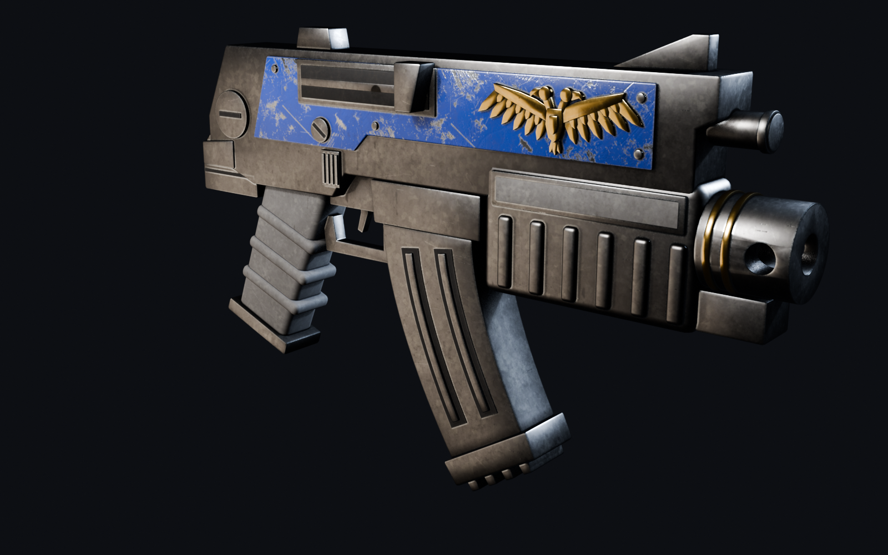

## En el juego (Godot)

| Reposo | Disparo |
|---|---|
| 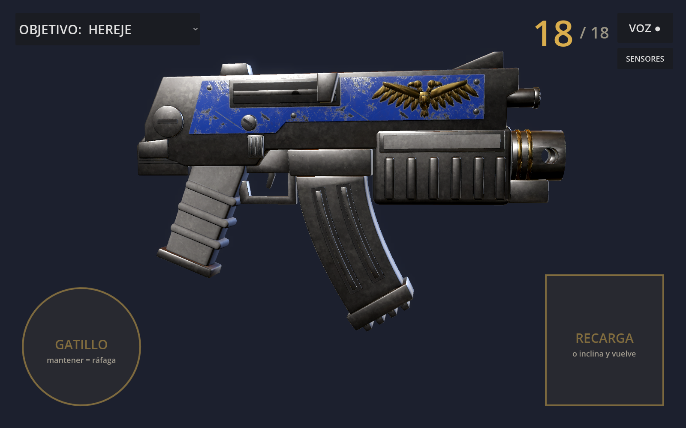 | 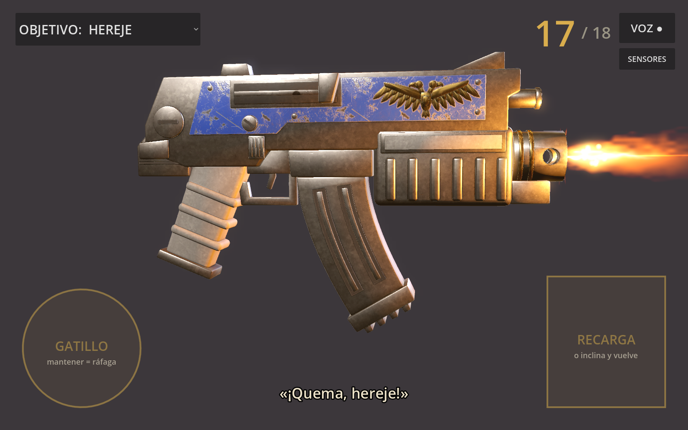 |
| **Humo** | **Recarga** |
| 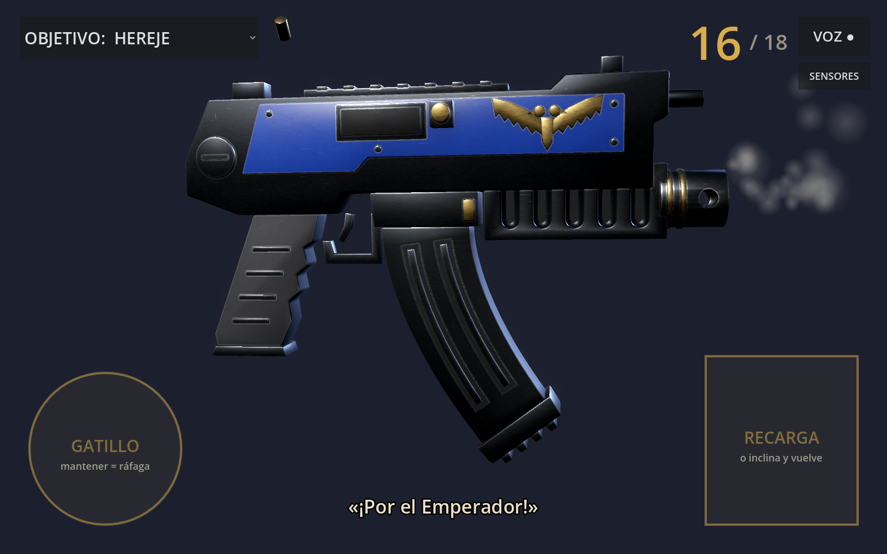 | 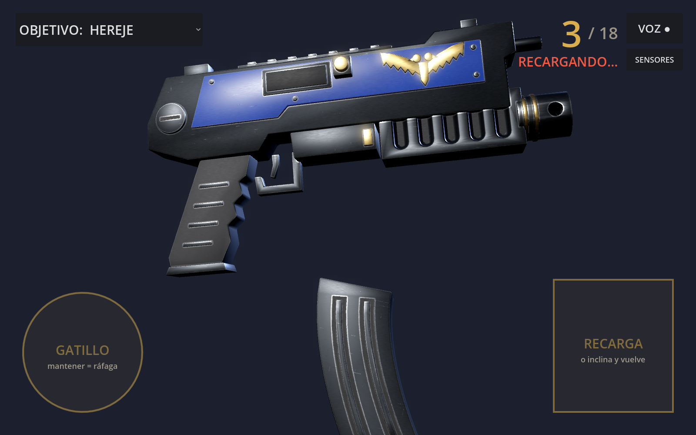 |
| **Cañón caliente** | **Panel de sensores** |
| 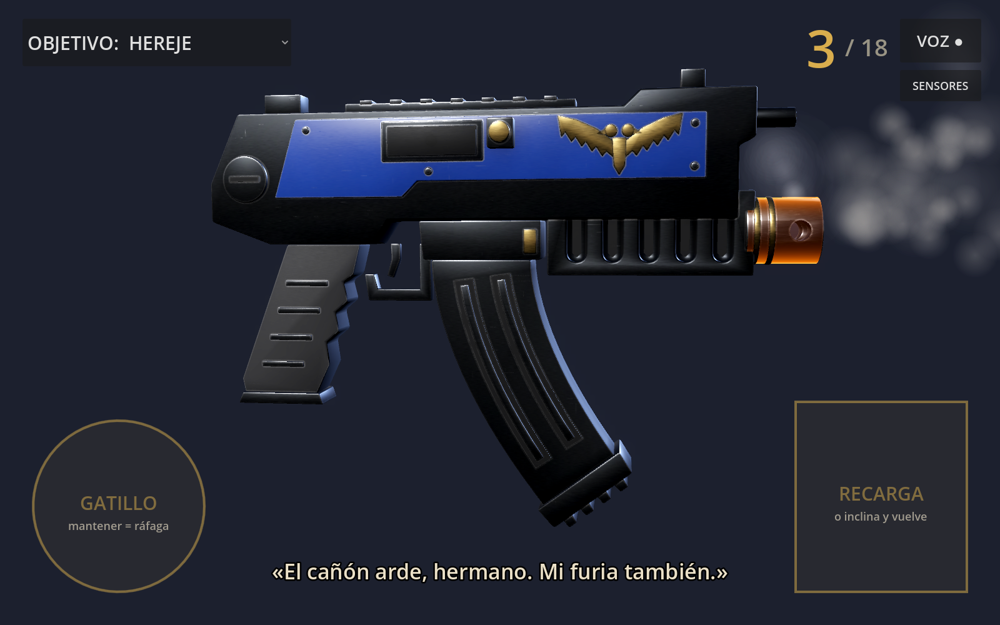 | 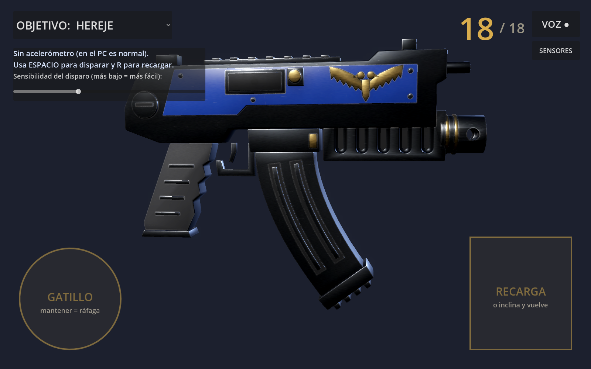 |

## El modelo (Blender)

Todo el arma se construye desde cero con un solo script de Python
([`blender/crear_bolter.py`](blender/crear_bolter.py)), que arma la malla, mezcla los materiales
escaneados, hornea las texturas PBR, crea las animaciones y exporta el `.glb` para Godot.

| Lateral | Disparo |
|---|---|
| 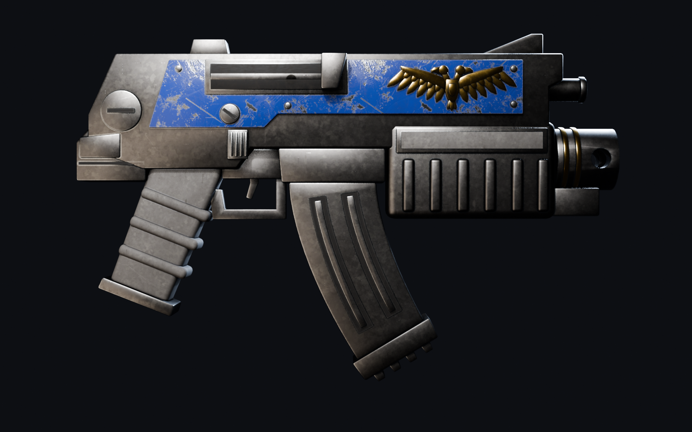 | 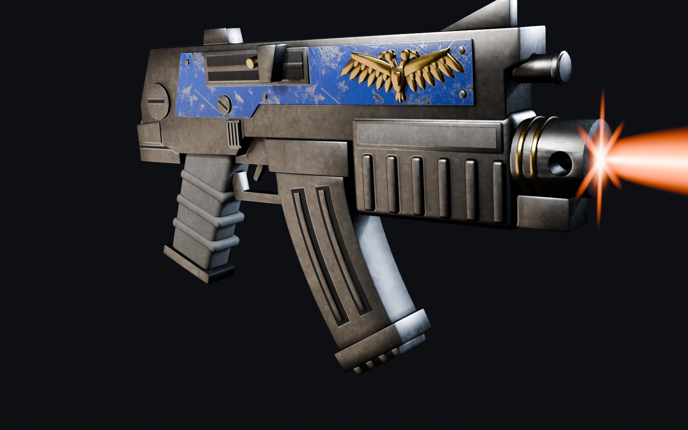 |
| **Recarga: cargador fuera** | **Recarga: palanca** |
| 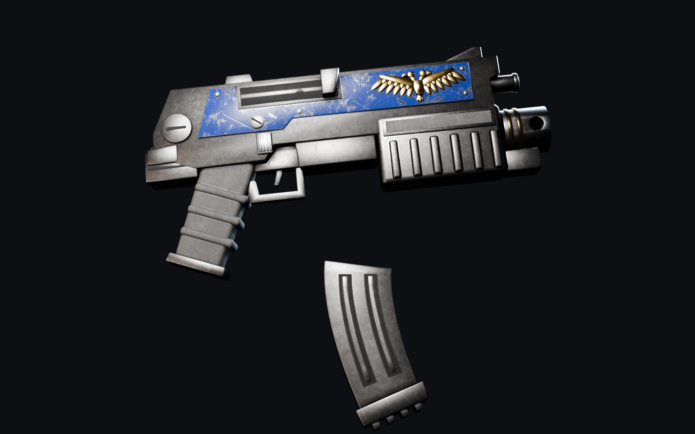 | 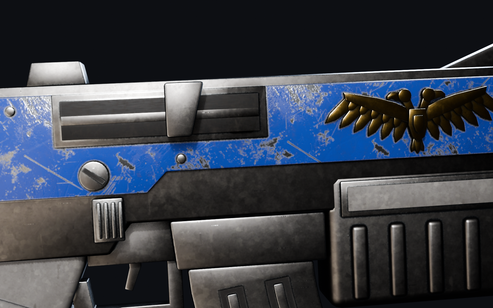 |

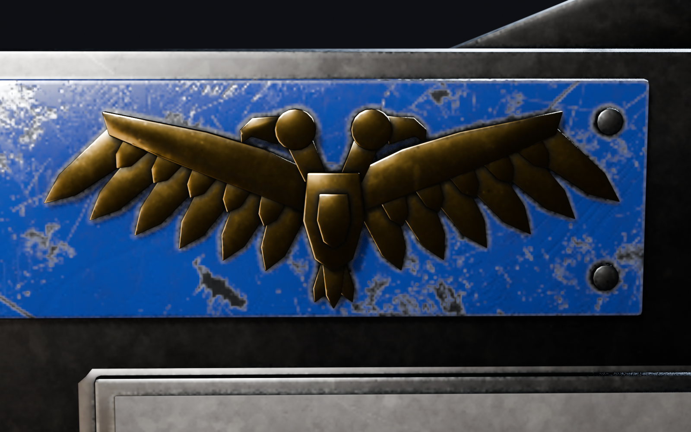

## Cómo está hecho

| Parte | Herramienta |
|---|---|
| Modelo, texturas horneadas y animaciones | Blender 4.5 (script de Python, modo `--background`) |
| Juego, sensores y shaders | Godot 4.7 (GDScript), exportado a Android |
| Sonidos | Grabaciones libres mezcladas con ffmpeg ([`audio/mezclar_sonidos.sh`](audio/mezclar_sonidos.sh)) |

La documentación técnica completa (cómo regenerar todo, trampas encontradas y pendientes) está
en [`LEEME.md`](LEEME.md).

## Créditos

Sonidos de OpenGameArt (CC0, CC-BY 3.0 y CC-BY-SA 3.0), materiales de ambientCG (CC0) y HDRI de
Poly Haven (CC0). Detalle de autores y licencias en [`CREDITOS.md`](CREDITOS.md).

## Aviso

Proyecto de fan **sin fines de lucro**, no oficial y sin relación con Games Workshop.
Warhammer 40.000, los Ultramarines, el bólter y el águila imperial son marcas y propiedad de
Games Workshop Limited.
